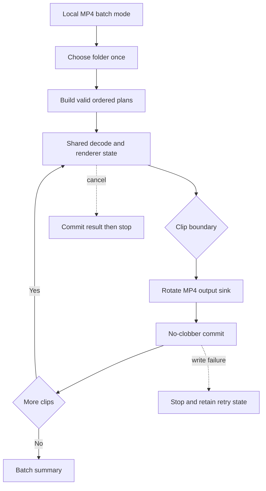

# Spec: Batch Export Timeline Clips as Separate MP4 Files

## Context Snapshot
- Project / module: Recordly-Keyviz-X; local export flow in the Electron video editor.
- Stack / runtime: Electron + React + TypeScript; Vitest and Playwright; `npm` with `package-lock.json`.
- Current behavior: the editor stores an ordered `ClipRegion` sequence, with per-clip speed and timeline effects. Local Export renders the whole timeline once and saves one file. The MP4 renderer uses separate source, cursor, and timeline clocks; export-side file finalization can replace an existing destination.
- Desired behavior: add a Local mode that exports every valid timeline clip as its own MP4 in one batch action. The user chooses the destination folder once. Existing full-timeline MP4/GIF and Link flows stay unchanged.
- Relevant files to read:
  - `src/components/video-editor/types.ts` — clip, zoom, webcam, audio, and caption time domains.
  - `src/components/video-editor/clipSequence.ts`, `clipSplit.ts`, and `captionTimeline.ts` — clip order, source-time mapping, and caption projection.
  - `src/components/video-editor/audio/useSourceAudioTrackSettings.ts` — per-clip source-audio settings and default inheritance.
  - `src/components/video-editor/VideoEditor.tsx` — current full-timeline caption-sidecar payload construction.
  - `src/components/video-editor/export/useExportRunner.ts` and `buildExportRenderOptions.ts` — current render and export lifecycle.
  - `src/lib/exporter/modernVideoExporter.ts`, `streamingDecoder.ts`, and `videoTimelineSegments.ts` — decode/render timestamps and frame grid.
  - `src/lib/exporter/modernFrameRenderer.ts` and `videoPlayback/zoomRegionUtils.ts` — stateful camera, cursor-follow, and zoom transitions.
  - `src/lib/exporter/offlineAudioProcessor.ts` and `audioTimelineProcessor.ts` — source audio and timeline overlays.
  - `electron/ipc/register/export.ts`, `exportCaptionSidecars.ts`, and `electron/preload.ts` — current save/sidecar IPC behavior.
  - `editorPreferences.ts`, `exportPreferences.ts`, `useExportSettings.ts`, `EditorExportMenu.tsx`, and `ExportSettingsMenu.tsx` — persisted mode and Local/Link UI.
- Existing constraints: batch is Local-only; preserve the incumbent Publish popover; do not change recording-folder preferences; never use the existing replacement behavior for batch output. Visual reference: `docs/specs/SPEC-2026-10-12-recordly-batch-clip-export/visuals/current-export-menu.png`.

## Objective
- Export 10 timeline clips with one batch Export action, one destination-folder selection, and one MP4 per clip.
- Keep the current full-timeline export and Link/share behavior intact.
- Make each output a faithful rendering of its interval in the edited timeline, including effects whose state crosses a clip boundary.

## Scope
- In:
  - Add `Full timeline` and `Separate clips` modes to Local export. Full timeline is the fresh-install and legacy-preference default; remember the last valid mode.
  - Version 1 `Separate clips` exports MP4 only. If GIF is selected, keep the existing full-timeline GIF flow; disable Separate clips with a clear localized explanation. Never silently change the selected format or mode.
  - Export every valid clip in timeline order. A clip is valid when its timeline bounds and speed are finite, `endMs > startMs`, `speed > 0`, and its computed source interval is inside the loaded recording and any optional `sourceMinMs`/`sourceMaxMs` bounds. Invalid clips are skipped and named in the batch summary; if none are valid, disable batch Export and do not open the folder picker.
  - Choose a folder once and save without per-clip dialogs. Suggested basename: `<source-basename>-clip-01.mp4`, with width based on clip count; collision suffixes are `-2`, `-3`, etc. The main process is authoritative and must never overwrite.
  - Preserve the rendered result at each original timeline frame, including speed, zoom, annotations, cursor/cursor-follow, captions, webcam, wallpaper, source audio, and imported audio.
  - Show `N/total` progress, support cancellation, retain completed files, expose recovery for failed/unwritten clips, and report sidecar warnings separately from video success.
- Out:
  - Separate GIF files, cloud Link/share batches, arbitrary clip selection, single-selected-clip export, ZIP packaging, parallel rendering, and timeline editing changes.

## Thuật ngữ và time-base contract
- **Timeline clip**: one `ClipRegion`. `startMs`/`endMs` are edited-timeline positions; `sourceStartMs` is the source-recording in-point; `speed` maps timeline duration to source duration.
- **Full-timeline export**: existing output containing the edited sequence as one file.
- **Separate-clips batch**: one run that writes one MP4 per valid timeline clip, in timeline order.
- For clip `c`, define `T0 = c.startMs`, `T1 = c.endMs`, `S0 = getClipSourceStartMs(c)`, `S1 = getClipSourceEndMs(c)`, and `U` as clip-local output time. For a sampled original timeline time `T`, `U = T - T0` and `S = S0 + U * c.speed`.
- Preserve the current full-timeline frame grid: `firstFrame = ceil(T0 * fps)`, `endFrame = ceil(T1 * fps)`. Output frame `i` samples original timeline frame `T = (firstFrame + i) / fps`, maps to source time `S`, and is muxed with clip-local PTS `i / fps`. Do not recompute frame count from `ceil((T1 - T0) * fps)`; fractional-frame cuts would drift.

### Track clock and clip projection

| Data | Clock used by current renderer | Batch rule |
|---|---|---|
| Video source frames | Source `S` | Decode from `[S0, S1)` at `c.speed`; keep `S0` independent from `T0`. |
| Zoom and annotations | Edited timeline `T` | Evaluate at original `T`; retain neighboring zoom regions needed for connected transitions. Do not crop away a connected pair that affects frames inside the clip. |
| Cursor telemetry, cursor-follow, webcam video and `visibleRanges` | Source `S`; webcam applies its existing `timeOffsetMs` | Keep/source-filter in source time; do not blindly subtract `T0`. |
| Video wallpaper/background video | Edited timeline `T` | Sample the same original timeline time as full-timeline rendering. |
| Visual captions and word timings | Source time consumed by the renderer | Intersect cues/words with `[S0, S1)` and keep the clock expected by the renderer. |
| Imported `AudioRegion` overlays | Edited timeline `T` plus file-buffer offset | Intersect with `[T0, T1)`, rebase output placement to `U`, and preserve `sourceOffsetMs = overlapStart - region.startMs` so a clipped region does not restart its audio file at offset zero. |
| MP4 caption sidecar | Clip-local output `U` | Keep existing cue-level SRT/VTT semantics: intersect cues with the clip's source window, convert cue bounds by `speed`, and emit timestamps in `[0, outputDuration]`. Word timing remains for in-video captions and is not serialized in sidecars v1. Never reuse the full-timeline sidecar payload. |
| Source audio | Source interval plus per-clip track settings | Resolve settings by `clip.id` merged with defaults. `clip.muted` mutes source audio only; imported `AudioRegion` overlays remain unaffected. `showSourceAudio` controls timeline track visibility only and does not change export audio. |

## UX Baseline
1. Keyboard: mode and Export controls are reachable/operable with keyboard; Enter/Space activates; Escape closes only when no commit is in flight.
2. Focus: preserve existing focus styling and position across mode changes.
3. A11y: named mode group; progress and final/retry state announced as status; controls have action labels.
4. Viewport: popover stays within the editor window at every supported size; no clipped controls.
5. States: idle; no valid clips; GIF selected while batch mode is unavailable; folder canceled; rendering N/total; cancel/commit race; complete; partial render failure; output-write failure; sidecar warning; retry.
6. Consistency: extend existing controls/tokens only; no new visual system or dependency.
7. Platform: use Electron's native folder picker; never ask for a typed path.
8. Copy: distinguish Full timeline / Separate clips; CTA names valid clip count; errors state what saved, what failed, and the next safe action.

## Assumptions
- The batch includes every valid clip, not just selected/highlighted clips.
- User confirmed on 2026-10-23: Separate-clips v1 is MP4-only; GIF remains full-timeline-only.
- User confirmed on 2026-10-23: separate clip frames must match the corresponding full-timeline rendered frames, including stateful zoom/cursor/camera at boundaries; renderer state cannot reset per clip.
- User confirmed on 2026-10-23: caption sidecars keep existing cue-level SRT/VTT semantics; word timing remains for in-video captions only.
- User confirmed on 2026-10-24: allow `COPYFILE_EXCL` fallback on filesystems without hard links; never overwrite an existing destination, while acknowledging a new output may be visible during the copy.
- Video output commit failure stops the batch; renderer failure records that clip and continues. Caption sidecar write failure is a non-fatal warning: the MP4 counts as saved, but the summary names the missing sidecar.
- Existing preference data without `exportMode`, or with an invalid value, normalizes to `full-timeline`.

## Open Questions
- None. Owner confirmed final-build Electron UAT PASS, including the 10-clip one-picker/one-batch case; final independent code review passed. Archive verification remains.

## Approach
- Create a pure `ClipExportPlan` for each valid clip. It carries original timeline/source bounds, preserved frame-grid indices, per-clip source-audio settings, imported-audio buffer offsets, source-clock caption/cursor/webcam data, timeline-clock visual effects, and clip-local sidecar cues. It never mutates editor state.
- Use one timeline-ordered decode/render-state session for the batch and rotate MP4 encoder/muxer outputs at clip boundaries. Keep one camera/cursor renderer state across the sequence; output PTS resets for each file while effect evaluation stays on original clocks. A fresh renderer per clip is not acceptable unless it is primed to reproduce the same state and passes the same frame-equivalence test.
- Add a one-shot main-process folder/batch session. Renderer sends an opaque batch ID and clip ordinal; main owns destination naming and finalization. The batch path must not call the current replace-capable `moveExportedTempFile` or arbitrary-path `write-exported-video-to-path`.
- Main process reserves/commits each video + enabled sidecar basename with no-clobber behavior. Existing/preflight collisions on either path select the next suffix. If a sidecar collision appears only after the MP4 is committed, keep the committed MP4 and existing sidecar, return a precise sidecar warning, and never rename/delete the published MP4. On volumes without hard-link support, use staged `COPYFILE_EXCL`: it prevents overwrite but the new destination may be visible while copying. Return typed error kinds (`render`, `write`, `sidecar`, `cancelled`) so the renderer does not classify errors by localized text.
- Batch orchestration does not call `handleExport` once per clip: it owns one batch cancellation token, one progress lifecycle, and one final summary. It must register every returned temp path before checking cancellation.
- Render errors continue to later clips. Output-write errors stop; retain the current managed temp for retry and let the user choose a folder again if needed. A partial-result `Retry failed clips` action retries only failed/unwritten clips; completed clips are never rendered or written again. Cancellation stops starting new clips; if atomic commit wins the race, count that clip as completed, otherwise clean only batch-owned temp/staging files.

## Diagram

## Bỏ qua
- Do not make Separate clips the default for existing users.
- Do not prompt for an output filename or folder per clip.
- Do not change the recordings-directory preference while choosing a batch destination.
- Do not silently switch GIF to MP4; show why Separate clips is unavailable for GIF.
- Do not redesign the Publish popover.

## Risks
- One renderer session split into independent MP4 muxers is a larger change than looping `handleExport`; prove the frame/state contract in a bounded integration fixture before wiring the UI.
- The existing `moveExportedTempFile` intentionally replaces destinations in some paths; it is unsafe for batch output. Sidecars currently use `fs.writeFile`, which can also overwrite. Exclusive-copy fallback on a no-hardlink filesystem prevents replacement but is not whole-file atomic visibility.
- Cancel can race with exporter return and finalization; define commit as the atomic no-replace publication point and keep explicit ownership of all batch temp/staging files.
- Clock confusion can shift captions, cursor, webcam, wallpaper, zoom, annotations, or audio. Use the table above as the oracle; never apply one generic “subtract clip start” transform to every track.
- Source audio settings are stored per clip but the current single export selects from the active/selected clip. Batch must resolve settings per plan.
- Existing `AudioRegion` has no file-buffer offset. Add an export-plan representation and teach the audio renderer to preserve this offset when an overlay crosses a clip boundary.
- Renderer/source and sidecar errors have different outcomes; typed errors and separate video/sidecar result counts are required.

## Task List

### Task 1: Define and test `ClipExportPlan`
- Acceptance:
  - Plan only clips with finite bounds, `endMs > startMs`, finite `speed > 0`, and a computed source interval within the loaded recording. Invalid clips are listed as skipped; zero valid plans produces an empty result and never opens the folder picker.
  - Store `T0/T1/S0/S1`, per-clip settings, original frame-grid indices, and mapping functions from the time-base table. Use half-open intervals `[start, end)` so a boundary frame/cue/word is not duplicated.
  - Preserve source-time cursor/caption/webcam semantics; keep `webcam.visibleRanges` in source time and apply `timeOffsetMs` exactly as the current renderer does.
  - Keep zoom/annotation and connected-zoom context on original timeline `T`. The plan may select the regions needed for the clip, but must not remove an adjacent region whose transition affects frames inside the clip.
  - Slice imported audio overlays at clip bounds and carry their original audio-file offset. Resolve source-audio settings using `getSourceAudioTrackSettingsForClip(clip.id)` with defaults; `muted` applies to source audio only; `showSourceAudio` remains timeline display metadata.
  - Produce visual-cue and per-clip sidecar projections separately: visual cues/words retain the renderer's source clock; cue-level sidecar timestamps map into clip-local output time and are clipped to `[0, duration]`. Word timing is not serialized to SRT/VTT in v1.
  - Do not mutate project/editor state; keep timeline order even when source order differs.
- Reproduce: `npm test -- src/components/video-editor/export/clipExportPlan.test.ts`
- Verify: cover nonzero `sourceStartMs` with speed != 1; reordered/split clips at non-1x speed; fractional-frame cuts at 24/30/60/59.94 FPS using the global frame grid; zero/invalid clips; zoom pair crossing a boundary; webcam source visibility/time offset; imported audio beginning before a clip and crossing both boundaries; caption/word cue intersections and sidecar time mapping.
- Files:
  - New `src/components/video-editor/export/clipExportPlan.ts` — follow `src/components/video-editor/clipSequence.ts`, `clipSplit.ts`, and `captionTimeline.ts` mapping patterns.
  - New `src/components/video-editor/export/clipExportPlan.test.ts` — follow `clipSequence.test.ts`, `clipSplit.test.ts`, and `projectPersistence.test.ts` boundary-test style.
  - `src/components/video-editor/types.ts` — add export-only mapping types only if they belong in shared domain types; avoid persisting transient source offsets unless required.
  - `src/components/video-editor/audio/useSourceAudioTrackSettings.ts` and `src/components/video-editor/VideoEditor.tsx` — follow `getSourceAudioTrackSettingsForClip` and the current caption-sidecar payload source.

### Task 2: Build a shared-state MP4 batch renderer
- Acceptance:
  - Render clips in timeline order through one renderer-state session; rotate MP4 output sinks at clip boundaries. Do not create a fresh unprimed renderer per file.
  - For each output frame, raw composited output must match the corresponding full-timeline render frame; encoded PTS starts at zero per file, sampled source frame remains on the original global frame grid.
  - On retry, decode/render prior timeline frames without creating output sinks so shared zoom/cursor state is primed; only failed/unwritten target clips are encoded and committed.
  - Cover stateful zoom spring, connected zoom transitions, cursor-follow/smoothing, webcam source visibility/offset, video wallpaper, annotations, and captions. Include a clip beginning mid-zoom and mid-cursor-follow, including a later clip retried after failure.
  - Use the `ClipExportPlan` from Task 1; resolve source audio settings per clip; preserve mute/source-audio policy and imported overlay buffer offsets.
  - MP4 sidecar cues are passed from that clip's plan, never from the full-timeline payload. Sidecar write failure is reported as a warning on a saved video, not counted as a render/write failure.
  - Batch is serial. It owns one cancellation token/progress lifecycle and does not call `handleExport` repeatedly, emit a save toast per clip, or remount preview per clip.
- Reproduce: `npm test -- src/lib/exporter/clipBatchExporter.test.ts`
- Verify: `npm run test:ui -- tests/ui/batch-clip-parity.spec.ts` uses the real `ModernFrameRenderer` to compare raw pre-encode pixels for a clip beginning mid-zoom/cursor-follow against matching Full-timeline frames, and uses `OfflineAudioContext` to compare imported-audio samples from the clipped source offset; also assert retry replay primes a later failed clip without creating outputs for completed clips, per-clip settings, sidecar payloads, cancellation, and no next clip after cancel. Real decoder/mux/IPC still requires Electron UAT.
- Files:
  - New `src/lib/exporter/clipBatchExporter.ts` and `.test.ts` — batch render adapter and per-output sink lifecycle.
  - `src/lib/exporter/modernVideoExporter.ts` and `modernFrameRenderer.ts` — reference for decoder/render/mux lifecycle; refactor shared internals rather than instantiate an unprimed renderer per clip.
  - `src/lib/exporter/streamingDecoder.ts` and `videoTimelineSegments.ts` — source runs, clip output positions, frame-grid sampling.
  - `src/components/video-editor/export/buildExportRenderOptions.ts` — project render configuration boundary.
  - `src/lib/exporter/offlineAudioProcessor.ts` — imported audio source offset and per-clip source audio settings.
  - New `tests/ui/batch-clip-parity.{html,tsx,spec.ts}` — actual renderer pixel parity and OfflineAudioContext sample-window fixture.
  - New `src/lib/exporter/clipAudioTimeline.test.ts` — offset and chunk-boundary scheduling tests for clipped overlays.

### Task 3: Add one-shot folder selection and safe batch finalization
- Acceptance:
  - Folder picker is opened once by the main process and returns an opaque batch/session reference; renderer cannot supply an arbitrary absolute output path for batch writes.
  - Main process owns candidate basename and suffix generation: `<source-basename>-clip-01.mp4`; on collision, try `-2`, `-3`, etc. Collision checks apply to MP4 and every enabled `.srt`/`.vtt` sidecar as one basename bundle.
  - Use atomic no-replace publication where the destination filesystem supports it; on filesystems without hard links, use same-directory staging plus `COPYFILE_EXCL`, which never overwrites but may expose the new file while bytes are copied. Recheck at commit, not only preflight. Never call the current replace-capable mover or overwrite-capable direct-path writer for batch output. Existing video/sidecar bytes remain unchanged on collision/race.
  - If an enabled sidecar collides only after its MP4 is published, keep that MP4 and the pre-existing sidecar untouched, then report a sidecar warning; never rename or delete an already-published video to recover the bundle suffix.
  - Finalize returns typed error kind and actual output path. Video write failure stops the batch; sidecar write failure leaves the committed video intact and is reported as a non-fatal per-clip warning.
  - Register ownership of every returned temp path before testing the cancel token. Before atomic commit, cancel prevents publication and cleans batch-owned temp/staging files; if commit wins, count that clip complete. No later clip starts after cancel.
  - After partial render failure, retry only failed clips. After write failure, retain a valid temp and allow choosing a destination folder again without re-rendering. Completed clips never get a new output sink, encoded output, or committed file; their frames may be replayed without encoding to restore shared renderer state before a later failed clip is retried.
- Reproduce: `npm test -- electron/ipc/register/batchExport.test.ts`
- Verify: pre-existing video, pre-existing sidecar only, and a file created after name preflight all remain byte-for-byte unchanged; preflight collisions select the next shared suffix; a sidecar-only race after MP4 publication preserves both files and reports a sidecar warning; cross-volume/Windows fallback does not replace; cancel before/after commit leaves no unowned temp/staging and reports completed output truthfully.
- Files:
  - `electron/ipc/register/export.ts` — existing app-managed temp and replacement-capable finalize; create a distinct batch-safe no-replace path.
  - `electron/ipc/handlers.ts` — register the batch IPC handlers.
  - New `electron/ipc/register/batchExport.ts` (or a dedicated bounded module) and tests — one-shot folder session, name reservation, no-clobber finalization, typed error outcomes.
  - `electron/ipc/register/exportCaptionSidecars.ts` — adapt sidecar output to collision-safe bundle semantics; preserve existing single-export behavior.
  - `electron/preload.ts` and `electron/electron-env.d.ts` — typed batch session/finalize contracts; do not expose arbitrary batch output paths.
  - `src/components/video-editor/export/exportPersistence.ts` — temp ownership/cleanup patterns; do not reuse the single `PendingExportSave` as batch state.

### Task 4: Integrate Local UI, preferences, locale coverage, and recovery
- Acceptance:
  - Local offers Full timeline and Separate clips. Fresh install and legacy preferences default to Full timeline; missing/invalid `exportMode` normalizes to Full timeline. Persist the last valid mode without changing it when destination changes.
  - Separate clips is MP4-only. With GIF selected, show a disabled mode plus localized explanation; do not silently switch format/mode.
  - CTA text handles 0, 1, and N valid clips. Zero disables action with an explanation and no folder picker. Batch progress reports clip N/total; partial result offers retry for failed/unwritten clips only; completed outputs are not repeated.
  - Link hides/never invokes batch controls, folder picker, or runner. Returning Local restores its chosen mode. Existing Full timeline MP4/GIF and Link behavior pass regression tests.
  - Add localized mode/CTA copy in `settings` and progress/result/retry/error copy in `editor` for every supported locale. Extend the checker or add a test that verifies interpolation-placeholder parity; `i18n:check` alone only checks key structure.
  - Preserve incumbent Publish popover styling and capture idle, progress, complete, and partial-result states.
  - Update the fork README's feature/usage copy to explain Local Separate clips MP4 export and the unchanged GIF Full timeline behavior.
- UX Contract:
  - Surface brief: none; narrow extension of existing Local Publish popover, not a new surface or visual-world replacement.
  - States: mode selected; GIF blocks batch mode; no valid clips; folder canceled; rendering N/total; cancel/commit race; complete; partial render failure; output-write failure with destination retry; sidecar warning; retry result.
  - Keyboard: mode selection/Export are keyboard-operable; Escape cannot close while commit is in flight.
  - A11y: named mode group; live progress/result status; recovery controls have action labels.
  - Viewport: popover remains within supported editor window sizes.
  - Token: preserve existing `ExportSettingsMenu`/`EditorExportMenu` styling and tokens.
- Skills: `flow`, `impeccable`
- Visual Ref: `docs/specs/SPEC-2026-10-12-recordly-batch-clip-export/visuals/current-export-menu.png`.
- Reproduce: `npm run test:ui -- tests/ui/batch-clip-export.spec.ts`
- Verify: add preference migration tests; UI test mode persistence and Local→Link→Local isolation; test no batch action/picker on Link; test zero/one/many clip CTA, GIF-disabled state, live N/total progress, retry-failed-only, sidecar warning and Link/Full-timeline regression; run `npm run i18n:check` with placeholder parity and `npm run typecheck`.
- Files:
  - `src/components/video-editor/ExportSettingsMenu.tsx` and `layout/EditorExportMenu.tsx` — current controls and destination routing.
  - `src/components/video-editor/export/useExportDialogActions.ts`, `useExportRunner.ts`, `useExportSettings.ts`, `useBatchClipExport.ts`, and `useEditorExportController.ts` — callback ownership, batch state, lifecycle and persisted setting integration.
  - `src/components/video-editor/editorPreferences.ts` and `exportPreferences.ts` — add `exportMode` normalization/default; follow existing preference migration patterns.
  - `src/i18n/locales/*/settings.json` and `editor.json`; `scripts/i18n-check.mjs` — all supported locales and placeholder parity.
  - `src/components/video-editor/export/useBatchClipExport.test.ts` and preference tests — cover retry partition/lifecycle and migration.
  - `src/components/video-editor/layout/EditorHeader.tsx` and `EditorShell.tsx` — wire the existing export controller to the Publish surface.
  - `tests/ui/publish.tsx`, new `tests/ui/batch-clip-export.{html,tsx,spec.ts}` — follow `publish-cloud.spec.ts` patterns.
  - `README.md` — update the fork-specific feature list and usage summary; leave upstream-derived `README.zh-CN.md` unchanged.

## Checkpoints
- After Task 1: plan tests prove each track's clock, source mapping, frame-grid policy, overlay source offset, zero-plan behavior, and no project mutation.
- After Task 2: the real `ModernFrameRenderer` pre-encode pixel fixture matches Full-timeline windows; the `OfflineAudioContext` fixture matches the imported-file sample window. Source-audio mix/FFmpeg mux parity remains part of Electron UAT; if frame parity fails, stop and revise the approach before IPC/UI work.
- After Task 3: tests prove atomic no-clobber across video/sidecar bundle, commit/cancel linearization, temp ownership, and retry without repeating completed clips.
- Before completion: run `npm run typecheck`, `npm run i18n:check`, all targeted plan/renderer/IPC tests, and `npm run test:ui -- tests/ui/batch-clip-export.spec.ts tests/ui/publish-cloud.spec.ts`; perform one real multi-clip MP4 UAT with different speed/zoom/audio settings.

## External Review Brief
### Reviewer needs to judge
- Do per-clip output frames match the full-timeline render at the same global frame positions while each MP4 has local PTS?
- Are source, timeline, and clip-local clocks mapped per the table, including stateful zoom/cursor/webcam and audio/captions?
- Does main-process no-clobber cover both video and sidecars under race, and is cancel truthful around commit?
- Are retries limited to failed/unwritten clips, while Full timeline and Link stay unchanged?
- Is MP4-only Separate clips a reasonable v1 scope, with GIF's existing full-timeline behavior clear?

### Reviewer should read first
- `src/components/video-editor/types.ts` and `clipExportPlan.ts` after implementation.
- `src/lib/exporter/modernVideoExporter.ts`, `modernFrameRenderer.ts`, `streamingDecodePipeline.ts`, and `offlineAudioProcessor.ts`.
- `electron/ipc/register/export.ts` and new batch-safe IPC/tests.
- `editorPreferences.ts`, `exportPreferences.ts`, `EditorExportMenu.tsx`, and the visual reference.

### Reviewer does not need to judge
- Cloud sharing internals, encoder benchmarking, or unrelated timeline editing.

## User Test
| Hành động | Kết quả kỳ vọng | Chuẩn nhìn |
|---|---|---|
| Chọn Local → Separate clips, có 10 clip, bấm Export một lần | Chọn folder một lần; tạo 10 MP4 tuần tự, không hỏi lưu từng file | `N/10`, file đánh số theo timeline order |
| Xuất clip bắt đầu giữa một zoom/cursor-follow đang chạy | Frame đầu và các frame sau khớp cùng thời điểm trong preview/full-timeline render | Không nhảy camera hoặc khởi động lại chuyển động |
| Dùng clip speed khác nhau, source-audio gain khác nhau, imported audio cắt qua biên và caption sidecar | Từng file giữ đúng đoạn hình/âm/caption của clip; `muted` chỉ mute source audio | Không lặp đầu imported audio, không sidecar chứa cue clip khác |
| Hủy trước commit và hủy đúng lúc commit | Không có clip sau bắt đầu; nếu commit đã thắng thì file được tính hoàn tất; temp còn lại được dọn hoặc giữ đúng retry state | Summary khớp file thật trong folder |
| Xuất vào folder có video hoặc sidecar trùng tên | Chọn basename suffix mới, không thay file cũ | Nội dung file cũ giữ nguyên |
| Không có clip hợp lệ hoặc chọn GIF khi Separate clips đang bật | Không mở folder picker; giải thích cách khắc phục / yêu cầu chuyển MP4 | Không báo batch rỗng thành công, không tự đổi format |
| Chuyển Local → Link → Local | Link giữ flow cũ; quay lại Local giữ mode; Link không gọi batch/picker | Không xuất nhầm batch |

**5 câu Y/N sau UAT:**
1. Popover có vừa cửa sổ, không cắt mất control không?
2. Chọn mode, bắt đầu và hủy batch có thao tác được bằng keyboard không?
3. Focus, selection và `N/total` progress có nhìn thấy/nghe được không?
4. Lỗi/hủy có nêu file nào đã lưu, file nào chưa, và cách retry không?
5. Mode mới có trông như phần tự nhiên của menu Local hiện tại không?

## Completion Gates
- [x] Plan tests pass for clocks, source/speed mapping, frame grid, overlays, captions/sidecars, and invalid/empty clips.
- [x] The real-renderer retry parity fixture proves pre-encode frame/state equality, imported-overlay sample-window mapping, and replay of prior zoom/cursor frames without output sinks for completed clips; owner confirmed Electron UAT PASS on the final build.
- [x] IPC tests prove no-clobber for video + sidecar bundle, race handling, cancel/commit boundary, and temp ownership.
- [x] Preference migration, placeholder parity, typecheck, and Local/Link/GIF UI regressions pass.
- [x] Finished UI screenshots cover idle, progress, complete, and partial/retry states; owner confirmed one folder pick and one batch action for 10 clips on the final build.

## Maintenance Context
- Read first: `clipExportPlan.ts`, `clipBatchExporter.ts`, `useBatchClipExport.ts`, and `electron/ipc/register/batchExport.ts`.
- Retry invariant: replay valid preceding plans through the shared renderer without sinks; `outputClipIds` determines which plans may be encoded/committed.
- Commit invariant: main-process no-clobber publication is the cancel/commit boundary; a committed clip remains complete if cancellation arrives afterward.
- Clock invariant: imported audio stays on clip-local output time with `sourceOffsetMs`; SRT/VTT stay cue-level and clip-local.
- Main verification command: `npm test -- src/components/video-editor/export/clipExportPlan.test.ts src/lib/exporter/clipBatchExporter.test.ts electron/ipc/register/batchExport.test.ts src/components/video-editor/export/useBatchClipExport.test.ts src/lib/exporter/clipAudioTimeline.test.ts src/components/video-editor/editorPreferences.test.ts`.

## Verification Record
- Owner reported `UAT PASS` on the final build and explicitly confirmed the 10-clip, one-folder-picker, one-batch-action case. Individual manual scenarios were not itemized.
- Repair lane after final-review fixes: `npm run typecheck`, `npm run i18n:check`, targeted Vitest (92/92), and batch/parity Playwright (14/14) passed. The real-renderer retry fixture matched 30 pre-encode frames and 12,000 imported-audio samples; it rendered prior timeline state without creating output for the completed clip. Retry-picker cancellation retained the prior summary/temp handles. Four UI-state screenshots were captured and visually checked.
- Vite production build and Electron main CJS smoke passed in the repair lane after the retry state-replay fix.
- Independent final code review: PASS; retry replay, invalid-clip filtering, retry-picker retention, and sink-init cleanup were inspected; no code-level finding remained.
- `publish-cloud.spec.ts` remains 8/9: its `Export Video` failure was reproduced on baseline `1b01adaf`, so it is unrelated to this feature.
